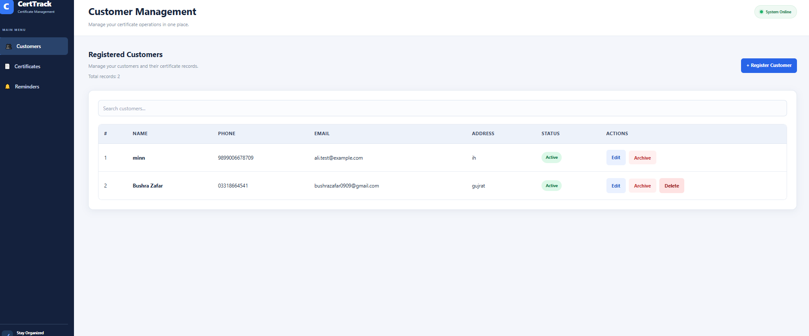

# CertTrack — Certificate Management System

CertTrack is a web-based certificate management system developed to help small inspection, compliance, and service businesses organize customer records, manage inspection certificates, and monitor upcoming inspection renewals.

## Project Demo

Watch the project demonstration:

[**Watch CertTrack on Loom**](https://www.loom.com/share/28c6652033e34e368d661573b367c64c)

**Note:** The “Prepare Reminders” feature was added after the Loom video was recorded, so this functionality is not demonstrated in the video. The current application includes this feature.

## Live Deployment

[Open CertTrack](https://taw-ind-certtrack-production.up.railway.app)

## Application Screenshots

### 1. Dashboard



### 2. Customer Management


### 3. Certificate Management


### 4. Certificate Registration


### 5. Customer Registration


### 6. Reminder Management


## Main Features

### Customer Management

- Register and view customer records.
- Edit existing customer information.
- Archive and restore customer records.
- Prevent permanent deletion when certificates are linked to a customer.

### Certificate Management

- Register, view, edit, and delete certificates.
- Associate certificates with customers.
- Maintain certificate numbers, issue dates, and next inspection dates.
- Validate unique certificate numbers and inspection dates.

### Renewal Status Tracking

Certificates are categorized based on their next inspection date:

- **Overdue:** The inspection date has passed.
- **Due Soon:** The inspection date is approaching within 30 days.
- **Up to Date:** The inspection date is more than 30 days away.

### Reminder Management

- Prepare reminder records for 30-day and 7-day reminder windows.
- Generate reminder message content.
- Prevent duplicate reminder records.
- View prepared reminders and their status.

> **SMS Integration Status:** The application currently prepares reminder records and message content. Actual SMS delivery and automatic reminder scheduling have not been implemented. Integration with an accessible SMS provider remains pending.

## Technology Stack

| Technology | Purpose                      |
| ---------- | ---------------------------- |
| PHP        | Backend programming language |
| Laravel    | Web application framework    |
| MySQL      | Relational database          |
| Blade      | Laravel templating engine    |
| HTML5      | Web page structure           |
| CSS3       | Styling and layout           |
| JavaScript | Frontend interactions        |
| Vite       | Frontend asset compilation   |
| npm        | Frontend package management  |

## Application Architecture

The project follows Laravel's MVC (Model-View-Controller) architecture, with a service layer for reminder preparation.

```text
CertTrack/
│
├── app/
│   ├── Http/
│   │   └── Controllers/
│   │       ├── CustomerController.php
│   │       ├── CertificateController.php
│   │       └── ReminderController.php
│   │
│   ├── Models/
│   │   ├── Customer.php
│   │   ├── Certificate.php
│   │   └── CertificateReminder.php
│   │
│   └── Services/
│       └── Reminder preparation logic
│
├── database/
│   └── migrations/
│
├── resources/
│   ├── views/
│   │   ├── customers/
│   │   ├── certificates/
│   │   ├── reminders/
│   │   └── layouts/
│   ├── css/
│   └── js/
│
├── docs/
│   └── screenshots/
│
├── routes/
│   └── web.php
│
├── .env.example
└── README.md
```

## Local Installation and Setup

### Requirements

- PHP
- Composer
- MySQL
- Node.js and npm

### Installation Steps

**1. Clone the repository**

```bash
git clone https://github.com/bushra0909/taw-ind-certtrack.git
```

**2. Navigate to the project directory**

```bash
cd taw-ind-certtrack
```

**3. Install PHP dependencies**

```bash
composer install
```

**4. Create the environment file**

For Windows PowerShell:

```powershell
Copy-Item .env.example .env
```

**5. Generate the application key**

```bash
php artisan key:generate
```

**6. Configure the database**

Update the database settings in `.env` and create the required database.

**7. Run database migrations**

```bash
php artisan migrate
```

**8. Install frontend dependencies**

```bash
npm install
```

**9. Build frontend assets**

```bash
npm run build
```

**10. Start the Laravel development server**

```bash
php artisan serve
```

**11. Open the application**

Visit:

`http://127.0.0.1:8000`

## Data Safety and Security

- Never commit `.env` or real customer information.
- Use `.env.example` for placeholder configuration.
- Customers with linked certificates cannot be permanently deleted.
- Archiving customers preserves their certificate history.
- Authentication and access control are required before public production deployment.

## Current Limitations and Future Improvements

- Integrate an SMS provider that supports the deployment region.
- Configure scheduled reminder generation and SMS delivery.
- Implement authentication and authorization.
- Expand automated feature testing.
- Add additional reporting and analytics capabilities.

## License

none

### Future Improvements

- **Multi-Administrator Management:** Allow the primary administrator to create, manage, and deactivate accounts for other authorized administrators.
- **Secure Password Reset:** Add a password recovery feature so administrators can reset forgotten passwords securely.
- **Role-Based Access Control:** Introduce different permission levels for administrators and staff members.
- **Automated SMS Reminders:** Integrate a suitable SMS provider and schedule automatic certificate renewal reminders.
